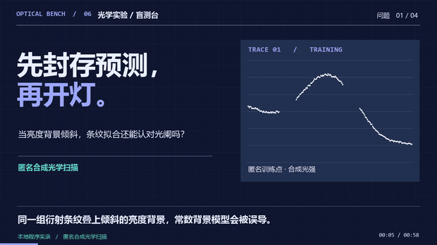

# 条纹盲测

光阑的形状和照明背景都能改变条纹。先只开放匿名训练区，让拟合器选择常数或线性背景并封存预测，然后解封留出点。这个顺序让模型选错和背景难救都可以追查。

[](demo/demo.mp4)
[播放中文演示](demo/demo.mp4) · [中文字幕](demo/字幕.srt) · [真实命令行时间记录](demo/session.cast)

59 秒。00:13 查看 trace-01 的两个留出区，00:28 揭晓 40 条扫描，00:45 核对预测摘要。

## 本地一键复演

在仓库根目录运行。使用 Python 3.11 或 3.12 标准库，无需联网或 GPU。入口按脚本位置查找数据，复制或重命名仓库后仍可使用。每次运行会将科研程序和原始输入复制到新的临时目录，重新计算并打印关键读数。

```sh
python -X utf8 demo/replay.py
```

## 揭盲前后各看什么

1. [匿名训练点](附件/复核实验/training/trace-01.csv)只含位置和光强。训练器在独立目录中运行，用预先冻结的复杂度惩罚选择背景并计算预测，写入 SHA-256 摘要。
2. 揭盲程序先重算摘要，再打开留出点和真值。视频中断开的两段是实际留出区，中间没有留出观测。[逐点预测、观测与残差](附件/复核实验/heldout_residuals.csv)
3. 五种条件各八条。斜背景从 0/8 正确通过提升到 8/8，留出 RMSE 中位数从 0.192967 降至 0.013278。平背景维持 8/8，弯曲、高噪、留出眩光三组各拒绝 8/8。[冻结规则](附件/复核实验/冻结方案.md) · [分组与逐条判定](附件/复核实验/results.json)

若要在工作副本内保留本机预测、摘要和重算的残差，从仓库根运行：

```sh
python -X utf8 附件/复核实验/lock_training.py
python -X utf8 附件/复核实验/reveal.py
```

两个命令会更新该工作副本里的预测与揭盲文件。一键入口在临时副本中运行。浮点序列化随 Python 版本可能改变摘要，揭盲校验的是本机同次生成的预测文件。样本是原创数字光学模拟，可公开教学复算；训练区完全相同的扫描仍可能在留出区发生眩光。

## 研究与演示材料

[一页说明](一页说明.pdf) · [完整研究报告](研究报告.pdf) · [展架海报](海报.pdf) · [答辩幻灯片](答辩.pptx) · [Mira 分轮工作流](附件/Mira%20工作流.md)

视频展示本地 Python 程序的实际复算与输出，图形和中文配音用于解读。Mira 桌面端可按分轮工作流导入相同材料；当前演示不含 Mira 对话分享链接。


[下载独立工作流附件 ZIP](B06-fringe-blind-test-附件包.zip)


[下载 80 × 200 cm 印刷海报 PDF](海报.pdf) · [下载 300 dpi 海报 JPG](海报.jpg)
