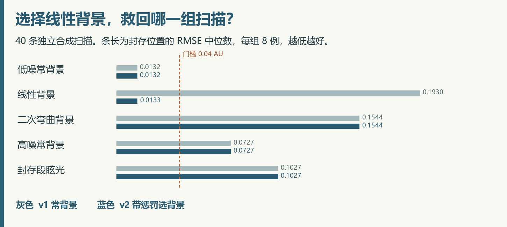

# 条纹盲测

从屏上光强反推狭缝，并让失配的扫描退出

## 研究背景与问题

在衍射教学实验里，中央亮斑在两种器件上都能出现。只比较中央峰会掩盖干涉条纹和背景偏置，拟合程序也总能返回某组参数。这个实验要求分析者在揭晓器件标签之前，给出可推翻自身结论的预测，再决定哪些参数可以写进报告。

一条光强曲线能否区分单缝与双缝？背景随位置变化时，怎样知道结论失效？

## 数据、权利与方法

样本是 632.8 nm 单色光、屏距 1000 mm 的三条原创数字模拟。每份 CSV 含位置、相对强度和预先固定的数据划分。允许复制、重算和公开教学演示。prepare.py 保存生成模型与噪声种子，盲测时先封存；run.py 仅读 CSV。

在小角度近似下，单缝曲线使用 sinc²(πax/λL)，双缝再乘 cos²(πdx/λL)。每组宽度与缝距都重估线性增益与常量背景。按训练残差平方和选择模型，36 个封存点仅用于验收；阈值 0.04 AU 是本数字实验事先设定的误差预算。封存段落在条纹较弱区域，扫描 B 上两模型的保留误差皆低于门槛，模型选择仍取决于训练曲线。不能把通过门槛当作唯一性证明。

原创示例的输入、生成约定及可执行方法随包提供。

## 分步验收与总体验收

1. 数据关：每条扫描 181 个互异坐标，145 个训练、36 个保留；拒绝非有限数和无保留集。
2. 拟合关：A、B 的缝宽偏差不超过一个 2 μm 网格步长，B 中心距偏差不超过一个 5 μm 步长。
3. 验收关：A、B 入选模型保留误差低于 0.04 AU；带斜背景的 C 必须触发拒报。三条均满足才接受本次盲测。

## 实验结果

1. 扫描 A 恢复单缝宽 120 μm，保留区 RMSE 为 0.0107 AU。
2. 扫描 B 恢复双缝宽 100 μm、中心距 320 μm，误差 0.0143 AU。
3. 扫描 C 加入斜背景，双缝误差升至 0.3176 AU，超过 0.04 AU 门槛。

扫描 B 的 145 个训练点选中双缝；在封存的 36 个位置上，预测与观测的均方根误差为 0.0143 AU。

## 执行环境与复现

本地使用 Windows x64、普通 CPU 和 Python 3.11 标准库。无需 GPU 或外部依赖。解压附件，在包含 run.py 的目录运行 `python -X utf8 run.py`，标准输出为完整 JSON。对照随包 results.json。如需重建固定种子输入，先运行 python prepare.py。

## 网格外压力测试

主实验 A、B 的真值恰好位于搜索网格上。扩展实验把四种几何真值移入网格节点之间：两种单缝宽 83.3、132.7 μm，两种双缝的（宽度、中心距）分别为（95.1，263.4）和（123.7，373.6）μm。每种几何在三个固定噪声种子与三种干扰条件下复算，共 36 条含 181 个位置的扫描。同一几何与种子下，各条件共享噪声抽样；各行统计为固定实验的条件比例。

执行前在附件《压力测试方案》锁定阈值和评价口径。推断脚本只接收匿名 CSV，模型通过训练 SSE 选定，再用固定的 36 个保留点验收。本次由同一公开实验程序生成数据并评分，生成真值和模型输出可事后复核。单缝宽误差须在 2 μm 以内，双缝还要求缝距误差在 5 μm 以内，器件类型必须正确。所有条件均沿用 0.04 AU 的发布门槛。

| 扰动条件 | 通过且几何正确 | 错误通过 | 拒报 | 未交付正确几何的比例 | 保留 RMSE 中位数 |
| --- | ---: | ---: | ---: | ---: | ---: |
| 常量背景，噪声 0.012 AU | 12/12 | 0 | 0 | 0% | 0.0127 AU |
| 常量背景，噪声 0.055 AU | 0/12 | 0 | 12 | 100% | 0.0547 AU |
| 斜背景，噪声 0.012 AU | 0/12 | 0 | 12 | 100% | 0.3168 AU |

低噪声常量背景组的最大缝宽误差为 1.3 μm，双缝中心距最大误差为 1.6 μm，达到了事先设定的至少 10/12 次成功交付目标。高噪声条件下，12 次拒报中有 11 次的拟合参数其实落在几何容差内；保留数据不足以满足误差预算，按规则不能发布。斜背景条件下有 4 次几何估计碰巧达标，12 次均被验收拦截，未见失配漏检。三种典型工况的结果只能支持这组模拟条件；靠近门槛的噪声、未知轴偏移及真实实验还需另测。

在附件目录执行 `python -X utf8 -B stress_test.py --output replay-stress.json`，对照 `stress_results.json`。逐扫描记录保留了生成参数与随机种子、两个模型的训练 SSE、各自保留误差、选择与拒报状态以及两项几何误差。

## 解释边界

使用有种子的合成扫描。光轴、波长和屏距均已知，参数只在离散网格上搜索。离轴、有限相干性和探测器饱和还需实验标定。

## Mira 实施与提交状态

附件中的《Mira 工作流》给出连续任务、输入和复核闸口。本文数字来自本地实际运行。桌面端对话与可访问的分享链接待生成。项目供 B 玩法飞书提交。

## 复核实验 v2 · 拟合到倾斜背景之后，哪些扫描仍应拒绝？

前文、答辩和 80 × 200 厘米海报对应原实验 v1，其背景项固定为常数。v2 增加一个待选项：背景可以随屏上位置线性变化。能不能加这一个参数，由训练数据决定。新实验另造 40 条数字扫描，均使用网格外的宽度与间距。四种器件几何 × 两个噪声种子形成每组八例，在相同几何与种子下成对改变干扰。该计算盲测使用原创合成数据，没有真实仪器或第三方盲审参与。

**先冻结拟合，再开启封存观测。** 每条扫描 181 个位置中预先保留两段各 18 点，覆盖负侧条纹和正侧近中心区域。原始 CSV 拆为两个物理目录。随机打乱的 40 个匿名编号不编码条件。执行脚本把 145 点训练 CSV 和拟合器复制到新临时目录，目录内没有保留强度、器件标签或真值。拟合完成后先写入 predictions.json 及 SHA-256，再运行单独的揭封程序。哈希用于核对揭封时使用的预测版本；生成程序、真值与完整数据均在包内，允许公开复算。

对相同的几何网格，分别用最小二乘求解正增益、背景截距以及可选的背景斜率。常背景管线只最小化训练 SSE，保留为 v1 对照；无惩罚管线可选两种背景，直接最小化 SSE；v2 在训练阶段最小化 n·ln(SSE/n) + I(有斜率)·ln(n)，只对背景多出的一个自由度施加相对惩罚。各候选均仅凭训练数据搜索。0.04 AU 的封存 RMSE 门槛、缝宽误差 ≤2 μm 和双缝间距误差 ≤5 μm 的交付标准全部沿用 v1。每种条件另抽一例，调用原版 run.py 核对常背景管线，五例的器件参数相同，保留 RMSE 差均小于 0.00000001 AU。

| 新扫描条件 | v1 正确交付 | v2 正确交付 | v2 选线性背景 | 封存 RMSE 中位数：v1 → v2（AU） |
| --- | ---: | ---: | ---: | --- |
| 低噪声、常背景 | 8/8 | 8/8 | 0/8 | 0.0132 → 0.0132 |
| 低噪声、线性背景 | 0/8 | 8/8 | 8/8 | 0.1930 → 0.0133 |
| 二次弯曲背景 | 0/8 | 0/8 | 0/8 | 0.1544 → 0.1544 |
| 高噪声、常背景 | 0/8 | 0/8 | 0/8 | 0.0727 → 0.0727 |
| 眩光仅落在封存段 | 0/8 | 0/8 | 0/8 | 0.1028 → 0.1028 |

低噪声常背景的八条扫描中，无惩罚搜索 8/8 都选择了多余斜率，v2 则 0/8；两者在这组的几何正确交付数都是八例。增加斜率适用于受测的正、负线性背景。二次曲率、随机强噪声、训练阶段从未出现的局部眩光共 24 条在 v2 中均拒报，没有错误通过。特别是眩光组与低噪声常背景组在相同几何、种子下的训练观测逐点相同，区别只能在揭封后显现。每组八次是本批合成条件的描述，不能推导光学平台真实检出率。

在 `附件/复核实验` 内依次运行 `python -X utf8 prepare.py`、`python -X utf8 lock_training.py`，记录预测 SHA-256，最后运行 `python -X utf8 reveal.py`。逐条估计、正确与拒报状态保存在 `results.json`，每个封存位置的实测值、预测值及残差保存在 `heldout_residuals.csv`。原仪器假设（波长、光轴、观察距离已知）仍然适用，强度超量程和器件漂移需另作核验。
